# Darts Battle

Game ném phi tiêu đối kháng online, bài tập lớn môn **Lập trình mạng** – Học viện Công nghệ Bưu chính Viễn thông (PTIT), nhóm 04.

Hai người chơi ở hai máy khác nhau đấu trực tiếp qua Internet (PvP), hoặc một người đấu với Bot do server điều khiển (PvE). Server giữ toàn quyền quyết định: client chỉ gửi tọa độ ném, còn kiểm tra lượt, tính điểm, đổi lượt và xác định thắng thua đều do server làm rồi đồng bộ cho cả hai bên.

| | |
|---|---|
| Phiên bản client | **2.5.3** – Windows x64 (bản macOS tạm dừng phát hành) |
| Máy chủ | `wss://game-backsite.handq2212.site/play` (Cloudflare Tunnel) |
| Tải về | [GitHub Releases](https://github.com/HandQ2212/Darts-Battle/releases) |

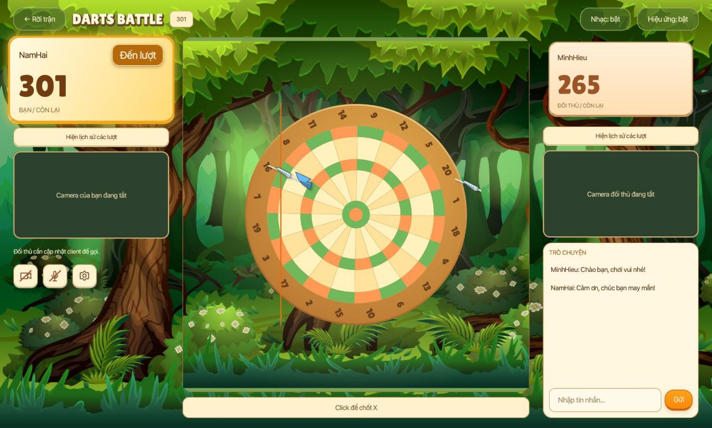

## Mục lục

1. [Tính năng](#1-tính-năng)
2. [Luật chơi](#2-luật-chơi)
3. [Hình ảnh](#3-hình-ảnh)
4. [Chơi game (dành cho người chơi)](#4-chơi-game-dành-cho-người-chơi)
5. [Kiến trúc và công nghệ](#5-kiến-trúc-và-công-nghệ)
6. [Build và chạy từ mã nguồn](#6-build-và-chạy-từ-mã-nguồn)
7. [Kiểm thử](#7-kiểm-thử)
8. [Đóng gói và phát hành](#8-đóng-gói-và-phát-hành)
9. [Cấu trúc thư mục và tài liệu](#9-cấu-trúc-thư-mục-và-tài-liệu)
10. [Nhóm thực hiện](#10-nhóm-thực-hiện)

## 1. Tính năng

| Mã | Nhóm | Mô tả |
|---|---|---|
| F01 | Tài khoản | Đăng ký (tên 3–32 ký tự chữ/số/`_`, mật khẩu 6–128 ký tự), đăng nhập, đăng xuất. Mật khẩu băm PBKDF2 có salt. Mỗi tài khoản chỉ có một phiên tại một thời điểm. |
| F02 | Kết nối | Client tự kết nối tới server khi mở app và tự kết nối lại khi mất mạng; người chơi không phải nhập IP/cổng. |
| F03 | Sảnh chờ | Danh sách người online kèm trạng thái (rảnh, đang được mời, đang trong trận), cập nhật theo thời gian thực. |
| F04 | Mời đấu PvP | Gửi lời mời, nhận thông báo có đồng hồ đếm ngược, chấp nhận hoặc từ chối. Lời mời hết hạn sau 30 giây. Không mời được chính mình hoặc người đang bận. |
| F05 | Chơi với Bot | Bốn mức độ khó: Dễ, Trung bình, Khó, Cực khó. Bot chạy trên server và ném theo đúng luật như người. |
| F06 | Thi đấu | Bàn xoay đầu lượt, ngắm X/Y bằng chuột, luật 301. Hiệu ứng phi tiêu bay, điểm số, âm thanh, nhạc nền. |
| F07 | Tương tác trong trận | Chat, gọi thoại/video WebRTC giữa hai người chơi, rời trận, chơi lại nhiều ván trong cùng một phiên. |
| F08 | Xếp hạng | Bảng xếp hạng theo số trận thắng PvP; xem lịch sử của từng người chơi. |
| F09 | Lịch sử | Lịch sử trận PvP và PvE của bản thân, chi tiết từng lượt và từng phi tiêu. |
| F10 | Cập nhật | Nút **Kiểm tra cập nhật** ở màn đăng nhập. Client tải bản mới, kiểm tra chữ ký Ed25519 và SHA-256 rồi tự cài và mở lại. |

## 2. Luật chơi

- Mỗi người bắt đầu với **301 điểm**, hai bên luân phiên, mỗi lượt tối đa **3 phi tiêu**.
- Đầu mỗi lượt, server chọn ngẫu nhiên một góc 0–359°. Bàn phi tiêu phóng to, xoay nhiều vòng trong khoảng 2,8 giây rồi dừng ở góc đó. Chỉ khi bàn dừng mới được ném.
- Ngắm bằng hai vạch chạy: **click chuột trái lần 1 chốt X**, **lần 2 chốt Y và ném**. Giao điểm hai vạch là vị trí phi tiêu.
- Điểm: Single = điểm ô (1–20), Double ×2, Triple ×3, Outer bull 25, Bullseye 50, ngoài bàn 0.
- Điểm phi tiêu trừ vào điểm còn lại. Nếu vượt điểm còn lại (**BUST**), phi tiêu đó không tính nhưng vẫn mất một lượt ném.
- Về **đúng 0** thì thắng ngay (straight-out, không cần double-out).
- Rời trận, mất kết nối hoặc hết **120 giây** cho một lượt đều bị xử thua.

## 3. Hình ảnh

Ảnh chụp từ client 2.5.3 với hai tài khoản thử nghiệm.

| Tự kết nối khi mở app | Đăng nhập |
|---|---|
| 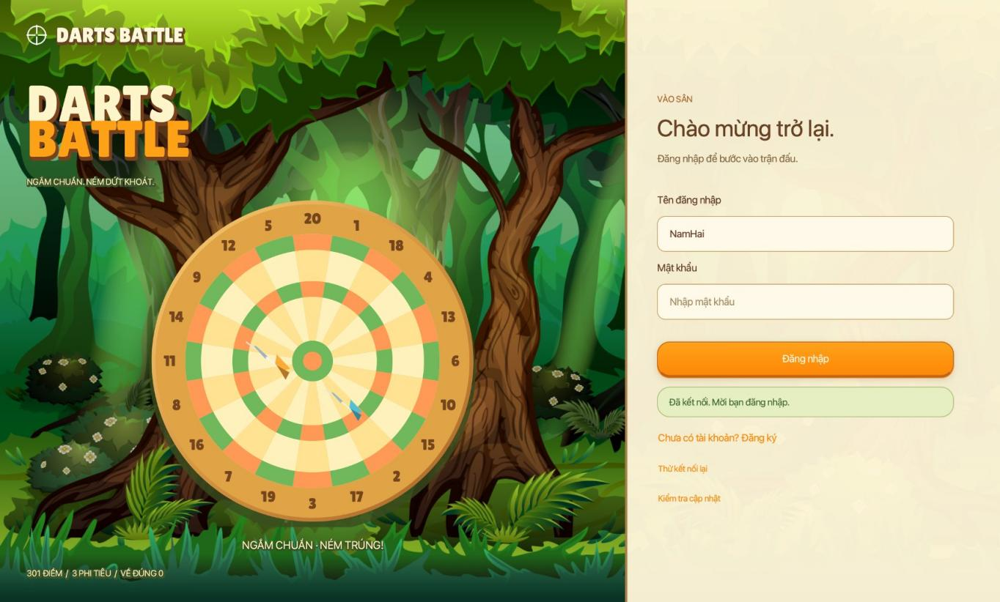 | 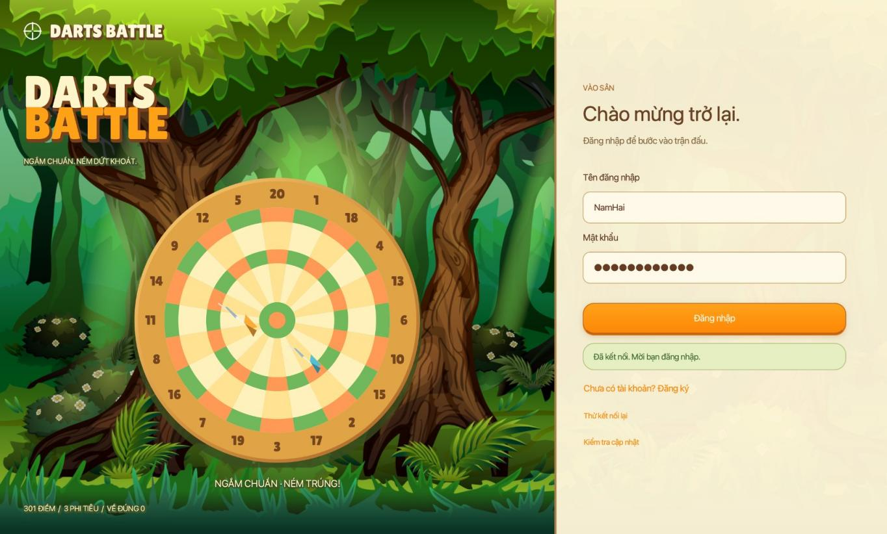 |

| Sảnh chính | Danh sách online và lời mời |
|---|---|
| 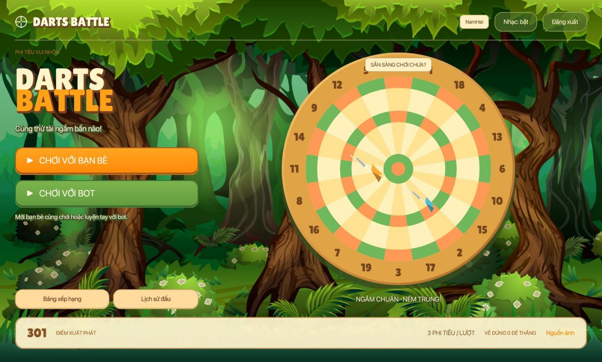 | 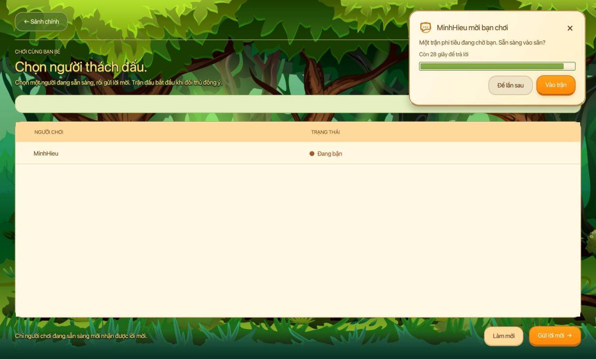 |

| Lịch sử các lượt trong trận | Kết quả trận |
|---|---|
| 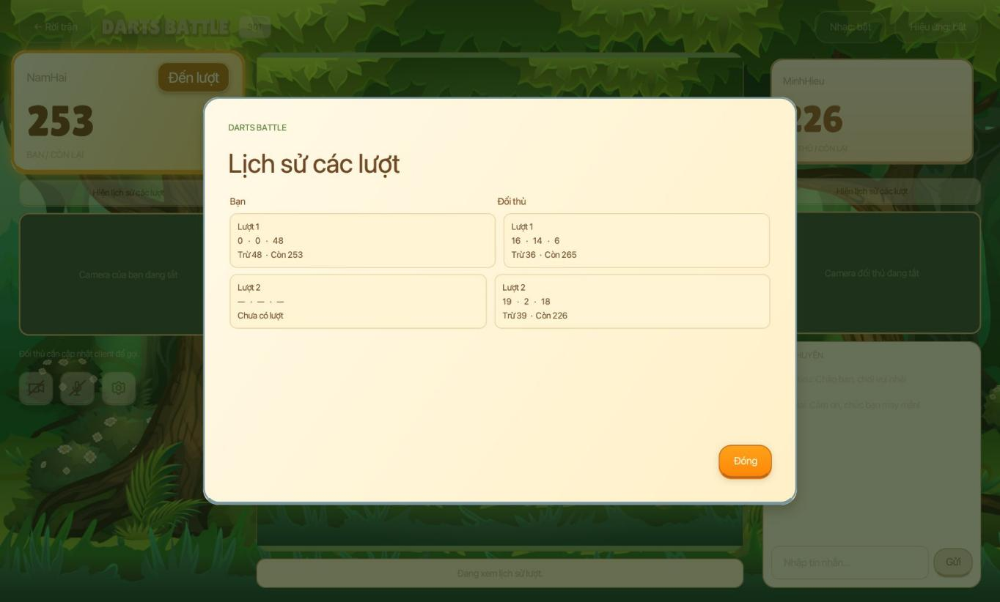 | 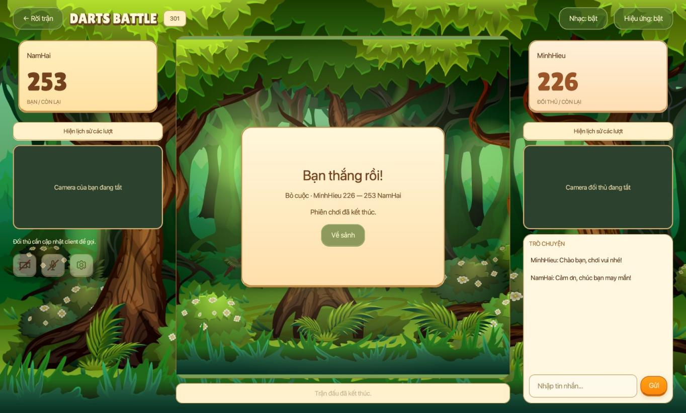 |

| Chọn độ khó Bot | Trận với Bot |
|---|---|
| 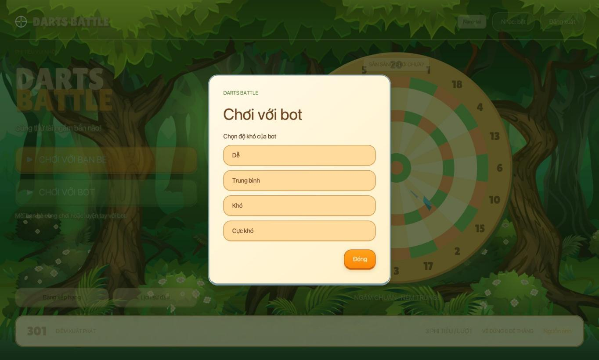 | 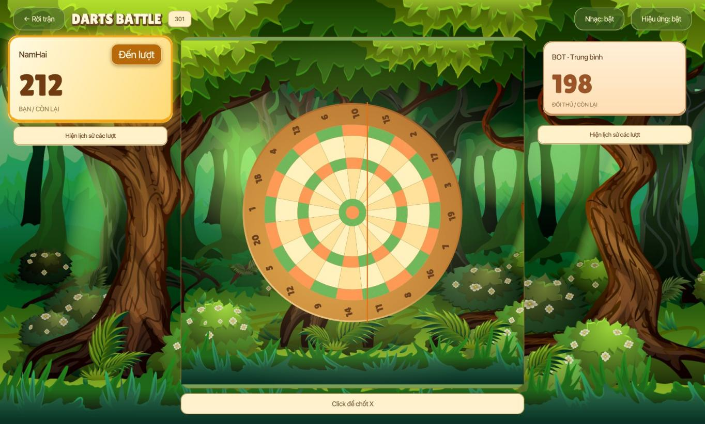 |

| Bảng xếp hạng | Lịch sử đấu |
|---|---|
| 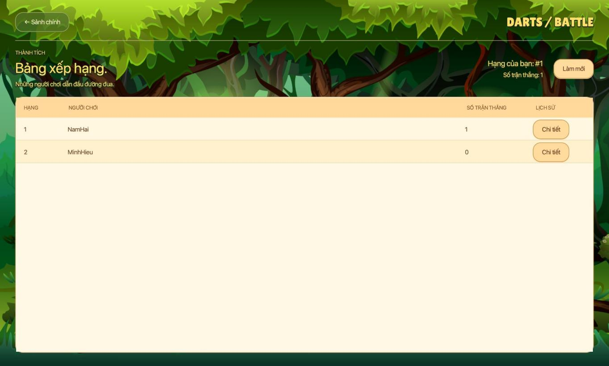 | 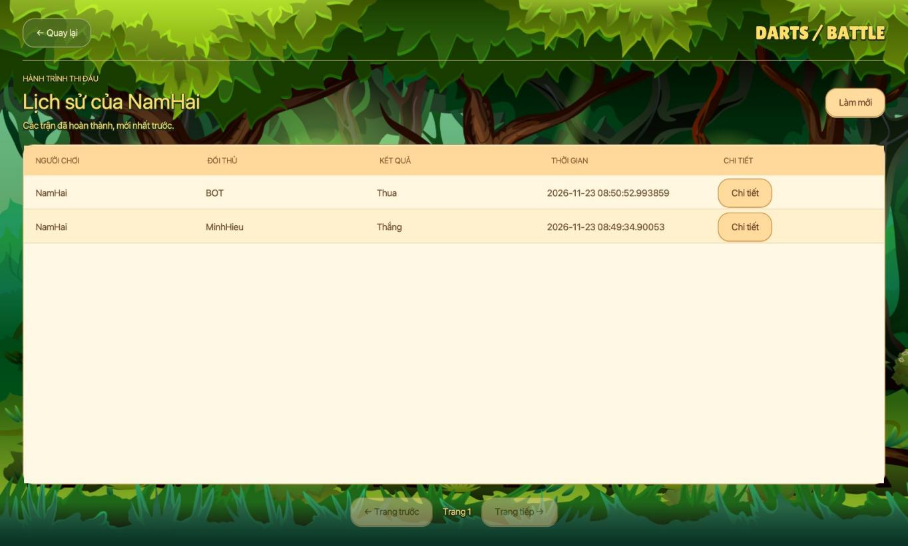 |

| Chi tiết trận | Đăng ký |
|---|---|
| 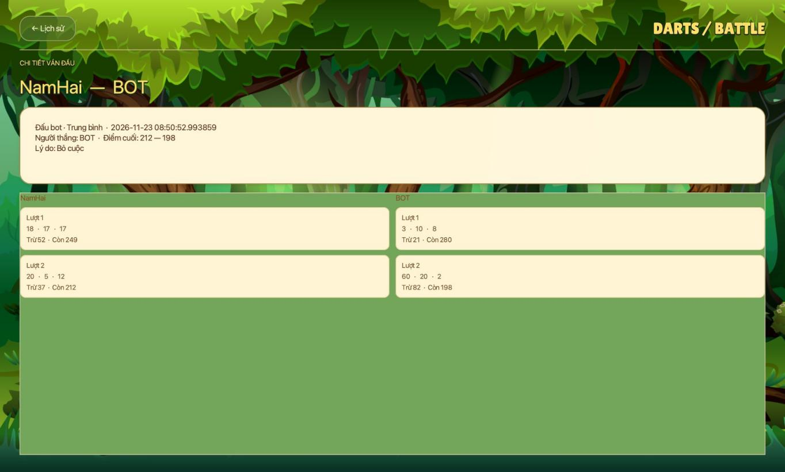 | 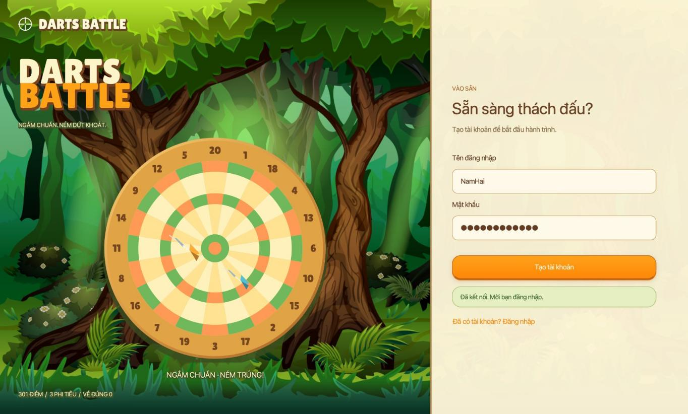 |

## 4. Chơi game (dành cho người chơi)

Yêu cầu: Windows 10/11 x64. Không cần cài Java, MySQL hay VPN vì gói đã kèm runtime.

1. Tải `DartsBattle-windows.zip` ở trang [Releases](https://github.com/HandQ2212/Darts-Battle/releases).
2. Giải nén **toàn bộ** ZIP (gồm `DartsBattle.exe`, thư mục `app/` và `runtime/`), không tách riêng file EXE. Thư mục giải nén cần có quyền ghi để updater hoạt động.
3. Mở `DartsBattle.exe`. App tự kết nối; khi màn đăng nhập báo đã kết nối thì nút đăng nhập mới mở.
4. Lần đầu chọn **Đăng ký**, sau đó đăng nhập. App chỉ nhớ tên đăng nhập, không lưu mật khẩu.
5. Ở sảnh chính chọn **Chơi cùng bạn bè** (mời người đang rảnh) hoặc **Chơi với Bot**.
6. Hết trận, cả hai bấm chơi lại để tiếp tục ván mới trong cùng phiên (cuộc gọi được giữ qua các ván).

Bản 2.5.2 trở lên tự kiểm tra cập nhật khi mở. Bản cũ hơn cần tải và cài thủ công một lần. Khi gặp lỗi kết nối, log client nằm ở `%USERPROFILE%\DartsBattle\logs` (xem [CONNECTION_DIAGNOSTICS.md](docs/CONNECTION_DIAGNOSTICS.md)).

## 5. Kiến trúc và công nghệ

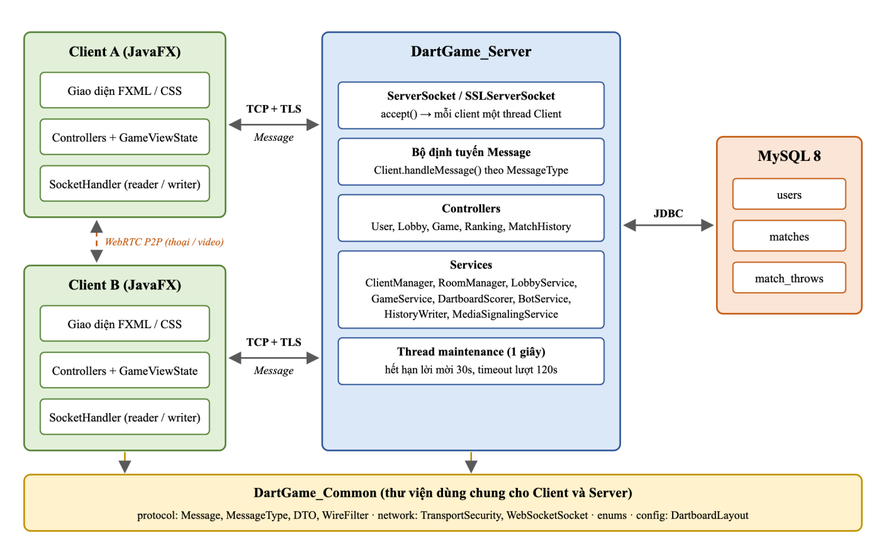

Dự án gồm ba project Java:

- **DartGame_Client** – app desktop JavaFX theo MVC (FXML/CSS + controllers). `SocketHandler` lo toàn bộ gửi/nhận bản tin; client không tự tính điểm, chỉ hiển thị trạng thái server gửi về.
- **DartGame_Server** – giữ toàn bộ trạng thái: người online, lời mời, phòng, trận đấu; thực thi luật, điều khiển Bot, ghi MySQL. Mô hình thread-per-client với luồng ghi riêng và hàng đợi giới hạn; mỗi phòng khóa riêng nên các trận chạy song song.
- **DartGame_Common** – thư viện dùng chung: `Message`, `MessageType`, các DTO, bộ lọc giải tuần tự hóa `WireFilter`, `TransportSecurity`, `WebSocketSocket`, hình học bàn `DartboardLayout`. Client và server phải build cùng một phiên bản Common.

Các tầng trên kênh truyền:

```text
Message { type, requestId, payload }   ← giao thức game (~47 loại bản tin)
Java Object Serialization              ← có whitelist lớp được giải tuần tự hóa
TLS 1.2/1.3                            ← client ghim chứng chỉ server
WebSocket (binary)                     ← chỉ khi đi qua Cloudflare Tunnel
TCP
```

Một số điểm thiết kế chính:

- Mỗi lần ném mang `requestId` riêng; gửi lặp không bị trừ điểm lần hai. Mỗi `MatchSnapshot` có `version` tăng dần để client bỏ sự kiện cũ/trùng.
- Heartbeat `PING` mỗi 5 giây; 45 giây không nhận dữ liệu thì coi như mất kết nối.
- Lịch sử trận và từng phi tiêu được ghi CSDL bất đồng bộ (hàng đợi, thử lại tối đa 3 lần), không làm chậm trận.
- Gọi thoại/video: WebRTC P2P giữa hai client; server chỉ chuyển signaling và cấp khóa Cloudflare TURN tạm thời khi hai mạng không kết nối trực tiếp được.

Chi tiết bản tin: [PROTOCOL.md](PROTOCOL.md). Thiết kế lớp: [CLASS_DESIGN.md](CLASS_DESIGN.md). Sơ đồ tuần tự: [UML_Sequence/](UML_Sequence).

**Triển khai thực tế:** server chạy trên macOS sau NAT, không mở cổng router. `cloudflared` tạo đường hầm ra Cloudflare; Cloudflare chuyển `wss://…/play` về `WebSocketBridge` (127.0.0.1:8444), bridge chuyển luồng byte sang Game Server TLS (127.0.0.1:8443). TLS vẫn đầu-cuối giữa client và game server nên Cloudflare chỉ thấy dữ liệu đã mã hóa. MySQL chỉ nghe localhost.

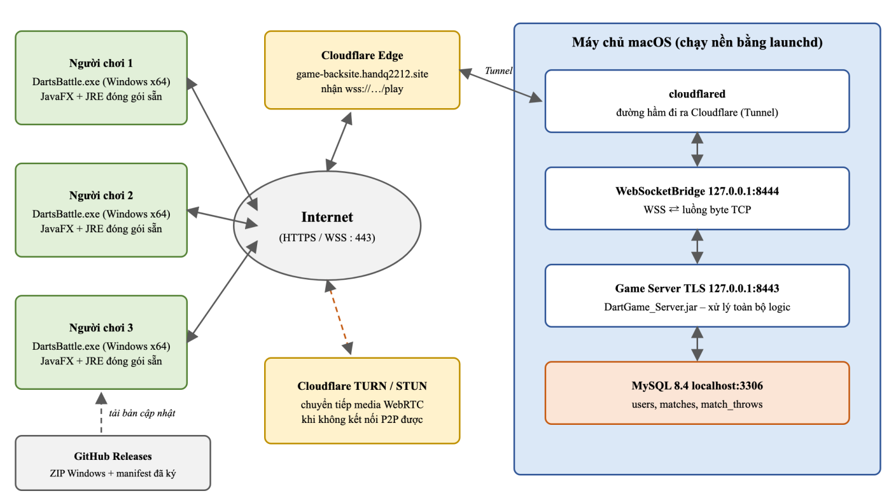

| Thành phần | Công nghệ |
|---|---|
| Ngôn ngữ | Java 17 |
| Giao diện | JavaFX 17 (FXML, CSS) |
| Truyền thông | Socket TCP, Java Object Serialization, WebSocket (Java-WebSocket) |
| Bảo mật | TLS 1.2/1.3 + certificate pinning, PBKDF2, Ed25519 (ký bản cập nhật) |
| Internet | Cloudflare Tunnel, Cloudflare TURN/STUN |
| Đa phương tiện | WebRTC (`webrtc-java`) |
| Cơ sở dữ liệu | MySQL 8 qua JDBC; H2 in-memory khi kiểm thử |
| Build, đóng gói | Python script + JDK, `jpackage`, GitHub Actions |

## 6. Build và chạy từ mã nguồn

Không còn phụ thuộc NetBeans: mọi thao tác đi qua `scripts/desktop.py`. Máy phát triển cần **JDK 17+**, **Python 3** và Git; script tự tải các JAR còn thiếu (JavaFX theo OS/kiến trúc, Java-WebSocket, SLF4J, WebRTC) từ Maven Central ở lần build đầu.

```sh
git clone https://github.com/HandQ2212/Darts-Battle.git
cd Darts-Battle
python3 scripts/desktop.py build all      # tạo darts-server.jar và darts-client.jar
```

### Chuẩn bị MySQL

```sql
CREATE DATABASE IF NOT EXISTS dart_socket_game CHARACTER SET utf8mb4;
CREATE USER IF NOT EXISTS 'darts'@'localhost' IDENTIFIED BY '<mật_khẩu>';
GRANT ALL PRIVILEGES ON dart_socket_game.* TO 'darts'@'localhost';
```

Server tự tạo các bảng `users`, `matches`, `match_throws` và tự nâng cấp schema (chỉ thêm cột/khóa, không ghi đè dữ liệu cũ) khi khởi động. Nên sao lưu bằng `mysqldump` trước khi chạy bản server mới trên CSDL đang có dữ liệu.

### Chạy server

Cấu hình đọc từ biến môi trường, không có mật khẩu nào trong mã nguồn:

```sh
export DARTS_DB_URL='jdbc:mysql://localhost:3306/dart_socket_game'
export DARTS_DB_USER='darts'
export DARTS_DB_PASSWORD='<mật_khẩu>'
python3 scripts/desktop.py run server
```

| Biến | Ý nghĩa |
|---|---|
| `DARTS_DB_URL`, `DARTS_DB_USER`, `DARTS_DB_PASSWORD` | Kết nối MySQL |
| `DARTS_PORT`, `DARTS_BIND` | Cổng/interface lắng nghe (mặc định 8080, mọi interface) |
| `DARTS_TLS_KEYSTORE`, `DARTS_TLS_PASSWORD` | Keystore TLS của server |
| `DARTS_WEBSOCKET_PORT` | Cổng WebSocket bridge cho Cloudflare Tunnel |
| `DARTS_TURN_CONFIG` hoặc `DARTS_TURN_KEY_ID` + `DARTS_TURN_API_TOKEN` | Khóa Cloudflare TURN (tùy chọn, xem [TURN_SETUP.md](docs/TURN_SETUP.md)) |

Trên máy chủ đã cấu hình sẵn, `./scripts/run-server.sh` đọc các biến này từ `.local/server.env` (thư mục `.local` không đưa lên Git).

### Chạy client

```sh
python3 scripts/desktop.py run client
```

Client đọc profile kết nối theo thứ tự `.local/client-profile.properties` rồi `deployment/client.properties` (domain, cổng, transport và chứng chỉ server `deployment/server-cert.pem`).

### Đưa server ra Internet

```sh
python3 scripts/install-server-service.py   # cài server thành dịch vụ launchd chạy nền, tự khởi động lại
cloudflared tunnel login
python3 scripts/connect-cloudflare.py       # tạo tunnel + DNS cho game-backsite.handq2212.site
python3 scripts/desktop.py probe            # kiểm tra đầu-cuối: mong đợi TLS được ghim và nhận PONG
```

Chi tiết: [ONE_CLICK_INTERNET.md](docs/ONE_CLICK_INTERNET.md).

## 7. Kiểm thử

```sh
python3 scripts/desktop.py test           # tích hợp: server thật + H2 in-memory (chế độ MySQL) + socket loopback
python3 scripts/desktop.py ui-test        # UI smoke test, cần phiên đồ họa
python3 scripts/desktop.py media-test     # signaling WebRTC giữa hai phiên
python3 scripts/desktop.py updater-test   # bộ tự cập nhật
python3 tests/update_release_test.py
```

`test` không chạm vào CSDL MySQL thật. Kết quả lần chạy gần nhất (23/11/2026):

| Nhóm | Kết quả |
|---|---|
| Gameplay qua TCP (đăng ký/đăng nhập, nhiều phòng, tổ hợp ô–vành–góc, BUST, lệnh trùng/sai lượt, chat, Bot, rời trận, mất kết nối, hết hạn lời mời/lượt) | 359/359 |
| Gameplay qua WebSocket + TLS | 359/359 |
| Transport/TLS (ghim chứng chỉ, từ chối chứng chỉ lạ, giới hạn frame) | 17/17 |
| Bot aim, phiên nhiều ván, lịch sử, nâng cấp CSDL | Đạt |

## 8. Đóng gói và phát hành

Chỉ phát hành client Windows x64. Workflow **Desktop packages** ([desktop-build.yml](.github/workflows/desktop-build.yml)) tự chạy khi push lên nhánh `lucnvm`: chạy test, đóng gói app-image bằng `jpackage` (kèm JRE) và đưa `DartsBattle-windows.zip` lên artifact. Workflow không giữ khóa ký và không tự đăng release.

Đóng gói thủ công trên Windows:

```powershell
python scripts/desktop.py package client --type app-image
python scripts/update-release.py archive     # -> dist/updates/DartsBattle-windows.zip
```

Ký manifest trên máy giữ khóa Ed25519 (`.local/update-signing/private.pem`, không đưa vào Git/CI):

```sh
python3 scripts/update-release.py manifest   # -> dist/updates/darts-update.txt
```

Một release trên GitHub gồm đúng hai file `DartsBattle-windows.zip` và `darts-update.txt`, tag theo `APP_VERSION` trong `scripts/desktop.py`. Quy trình đầy đủ: [AUTO_UPDATE.md](docs/AUTO_UPDATE.md).

## 9. Cấu trúc thư mục và tài liệu

```text
DartGame_Client/    app JavaFX: controllers/, views/ (FXML, CSS), ui/ (hiệu ứng, thông báo, cuộc gọi), updater/
DartGame_Server/    server: controllers/, services/, models/, database/
DartGame_Common/    protocol/, network/, enums/, config/
deployment/         profile client, chứng chỉ công khai server, mẫu cấu hình TURN
scripts/            build, chạy, đóng gói, phát hành, cài dịch vụ, Cloudflare
tests/              kiểm thử tích hợp, UI, media, updater
UML_Sequence/       sơ đồ tuần tự PlantUML
docs/               tài liệu chi tiết
```

| Tài liệu | Nội dung |
|---|---|
| [PROTOCOL.md](PROTOCOL.md) | Giao thức bản tin client–server |
| [CLASS_DESIGN.md](CLASS_DESIGN.md) | Thiết kế lớp |
| [docs/ONE_CLICK_INTERNET.md](docs/ONE_CLICK_INTERNET.md) | Kết nối qua Internet, Cloudflare Tunnel, vận hành server |
| [docs/DESKTOP_MULTIPLAYER_SETUP.md](docs/DESKTOP_MULTIPLAYER_SETUP.md) | Cài server, MySQL, chơi LAN (một phần mô tả bản v2.0) |
| [docs/AUTO_UPDATE.md](docs/AUTO_UPDATE.md) | Build, ký và phát hành bản cập nhật |
| [docs/TURN_SETUP.md](docs/TURN_SETUP.md) | Cấu hình Cloudflare TURN cho gọi thoại/video |
| [docs/CLIENT_RESKIN.md](docs/CLIENT_RESKIN.md) | Giao diện, hiệu ứng, thông báo |
| [docs/CONNECTION_DIAGNOSTICS.md](docs/CONNECTION_DIAGNOSTICS.md) | Log và chẩn đoán mất kết nối |
| [docs/MULTI_ROUND_RELEASE.md](docs/MULTI_ROUND_RELEASE.md) | Chơi nhiều ván, nâng cấp CSDL 2.4.0 |
| [docs/THIRD_PARTY_NOTICES.md](docs/THIRD_PARTY_NOTICES.md) | Giấy phép thư viện, ảnh, font |

**Hạn chế hiện tại:** chưa khôi phục trận đang chơi khi server khởi động lại hoặc người chơi rớt mạng; mỗi phòng chỉ hai người; client macOS tạm dừng phát hành; lịch sử đang chờ ghi có thể mất nếu server bị dừng đột ngột.

## 10. Nhóm thực hiện

Lớp D23CTPM01 – Nhóm học phần CT01 – Nhóm bài tập lớn 04.

| Thành viên | MSSV | Phụ trách |
|---|---|---|
| Văn Thị Mai Linh | B23DCCN489 | Kết nối mạng, TLS, xác thực, Cloudflare Tunnel, khung ứng dụng (F01, F02) |
| Nguyễn Nam Hải | B23DCCN277 | Sảnh chờ, lời mời, phòng đấu, chat, gọi thoại/video (F03, F04, F07) |
| Nguyễn Văn Minh Lực | B23DCCN516 | Luồng trận, bàn xoay, ngắm ném, luật 301, hiệu ứng (F06) |
| Giáp Minh Hiếu | B23DCCN299 | Bot, kết quả, xếp hạng, lịch sử, đóng gói và tự cập nhật (F05, F08, F09, F10) |

Tài nguyên đồ họa, font và âm thanh có nguồn và giấy phép ghi tại `DartGame_Client/src/assets/CREDITS.md`.
