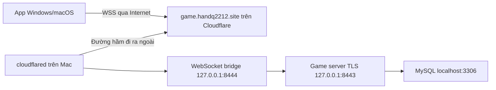

# Mở app, đăng nhập và chơi qua Internet

Client v2.1 giữ đăng nhập, tự kết nối và không yêu cầu người chơi nhập IP/cổng.
Endpoint được chủ server cài sẵn: `wss://game.handq2212.site/play`.

## Tên miền kết nối với Mac như thế nào?



Namecheap là nơi mua tên miền. DNS hiện đã dùng nameserver Cloudflare, vì vậy phần
DNS/tunnel được quản lý trong Cloudflare, không cần đổi nameserver ở Namecheap.
Subdomain `game` dành riêng cho game; không thay website/tunnel đang dùng domain gốc.

Mac chủ động kết nối tới Cloudflare Tunnel. Khi người chơi mở app, Cloudflare chuyển
kết nối về Mac qua tunnel này. Không cần IP Internet cố định hay mở cổng router.
Cloudflare Tunnel hỗ trợ WebSocket theo [tài liệu Cloudflare](https://developers.cloudflare.com/cloudflare-one/faq/cloudflare-tunnels-faq/).

Ngoài WSS ở lớp Cloudflare, byte stream game còn có TLS bên trong với chứng chỉ
được ghim trong app. Chỉ server trên Mac giữ private key. Client không cần cài VPN,
cloudflared, JDK, Python hay MySQL khi dùng bộ cài đã đóng kèm runtime.

## Trạng thái và bước thiết lập một lần của chủ server

Đã thực hiện trên Mac:

- Cài MySQL, database và tài khoản riêng của game.
- Cài cloudflared.
- Tạo chứng chỉ/private key riêng cho game; public certificate ở `deployment/server-cert.pem`.
- Cài dịch vụ `com.dartsbattle.server`, chạy nền khi đăng nhập Mac và khởi động lại nếu lỗi.
- Kiểm chứng dịch vụ đã cài qua `ws://127.0.0.1:8444/play` với TLS được ghim và game PONG.
- Chuẩn bị client v2.1 tự kết nối tới domain, hiển thị trạng thái và thử lại khi server chưa sẵn sàng.

- Đã xác thực Cloudflare, tạo tunnel `darts-battle-handq2212` và DNS `game.handq2212.site`.
- Đã cài dịch vụ `com.dartsbattle.cloudflared` chạy khi đăng nhập Mac.
- Ngày 23/10/2026, probe qua `wss://game.handq2212.site:443/play` thành công:
  `pinned TLSv1.3, game PONG received`. Đây là kiểm tra qua endpoint Internet từ Mac
  chủ; chưa thay thế việc chơi thử bằng hai máy ở hai mạng khác nhau.

Không phát hành bản v2.0 cũ cho luồng này; v2.0 dùng cấu hình kết nối thủ công
và chưa có WebSocket.

Các bước thiết lập dưới đây đã thực hiện trên Mac này; giữ lại để tham khảo khi cài lại:

```sh
cloudflared tunnel login
```

Trong trình duyệt, đăng nhập Cloudflare và chọn `handq2212.site`. Không gửi mật khẩu,
API token hay file `cert.pem` vào chat. Sau khi CLI báo xác thực thành công:

```sh
python3 scripts/connect-cloudflare.py
python3 scripts/desktop.py probe
```

Script tạo hoặc dùng lại tunnel riêng `darts-battle-handq2212`, thêm DNS cho
`game.handq2212.site`, rồi cài dịch vụ `com.dartsbattle.cloudflared`. Nó không ghi đè
DNS đã tồn tại và không sửa cấu hình tunnel/website cũ. Nếu subdomain đang dùng cho
mục đích khác, script dừng để kiểm tra thay vì thay nó âm thầm.

Không cần tự đặt A record tới IP LAN `192.168.x.x`. Script dùng route DNS của Cloudflare
Tunnel. Khi Mac đổi Wi-Fi/IP, domain vẫn trỏ tới tunnel, không cần build lại app.

Nếu tài khoản bật Cloudflare Access/SSO hoặc challenge bảo vệ toàn domain, cần kiểm tra
policy áp dụng cho subdomain game: app tự xử lý đăng nhập game, không mở trang SSO của
trình duyệt. Không tắt các policy bảo vệ những hostname khác.

## Người chơi làm gì?

1. Cài app đúng Windows/macOS và kiến trúc máy.
2. Mở **DartsBattle**. App tự kết nối, không có ô nhập IP hay cổng.
3. Đăng ký lần đầu hoặc đăng nhập. App chỉ nhớ tên đăng nhập, không lưu mật khẩu.
4. Chọn đối thủ và gửi lời mời, hoặc chọn chơi với bot.

Khi Mac/server hoặc mạng tạm ngừng, app hiển thị trạng thái chờ và tự thử kết nối lại.
Nút đăng nhập chỉ mở khi kết nối sẵn sàng. Không tự gửi lại mật khẩu hoặc khôi phục trận
đã bị xử thua do mất mạng.

Mac phải đang bật, chưa sleep và tài khoản chủ server đã đăng nhập macOS.
MySQL, game server và tunnel tự chạy nền; không cần mở Terminal mỗi lần chơi.
Dịch vụ game dùng JDK đã cài trên Mac; không gỡ JDK đó khi còn chạy server.

## Đóng gói và phát cho bạn bè

Các file gửi cho người chơi được gom riêng tại `dist/Player-Downloads/`:

- `Windows/DartsBattle-2.1.0-Windows-x64.zip`: giải nén toàn bộ rồi mở
  `DartsBattle/DartsBattle.cmd`. Gói portable kèm JRE Windows và JavaFX Windows,
  không yêu cầu cài Java. Gói tạo trên Mac chưa được chạy thử trên Windows thực tế.
- `Mac/DartsBattle-2.1.0-macOS-AppleSilicon.dmg`: mở DMG, kéo app vào Applications.
  Chưa có bộ cài Mac Intel.

Tạo/cập nhật thư mục này sau khi build DMG Mac bằng:

```sh
python3 scripts/package-player-downloads.py
```

Script lấy JRE Windows x64 từ Eclipse Temurin, kiểm tra SHA-256 của runtime,
biên dịch client cùng thư viện JavaFX Windows và đóng ZIP riêng. Đây là gói portable;
các lệnh build trực tiếp trên Windows bên dưới dành cho app-image/EXE native.

Profile chung nằm ở `deployment/client.properties`; chỉ có domain/cổng/transport,
không có thông tin MySQL, mật khẩu, private key hay quyền Cloudflare.
Public certificate là dữ liệu cần thiết để client nhận diện đúng game server.

Mac:

```sh
python3 scripts/desktop.py package client --type dmg
```

Windows x64, chạy tại máy build có JDK 17+ và Python:

```powershell
py scripts/desktop.py package client --type app-image
# Nếu đã cài WiX phù hợp với JDK:
py scripts/desktop.py package client --type exe
```

Không cần truyền `--server-host` mỗi lần vì profile đã có sẵn. Workflow
`.github/workflows/desktop-build.yml` dùng cùng profile cho cả Mac và Windows.
Gửi toàn bộ thư mục Windows app-image hoặc bộ cài, không chỉ file EXE riêng lẻ.
Bộ cài Mac hiện chưa ký Developer ID/notarize.

### macOS báo “app is damaged”

Bản đóng gói cũ giữ chữ ký launcher không còn hợp lệ sau khi `jpackage` tạo app.
Script đóng gói hiện ký ad-hoc toàn bộ app hoàn chỉnh và chạy
`codesign --verify --deep --strict` trước khi xuất app hoặc đưa app vào DMG/PKG.
Build lại gói bằng lệnh ở trên để thay bản cũ. Chữ ký ad-hoc dùng cho bản build
nội bộ; phát hành cho các Mac khác qua Internet vẫn cần Developer ID và notarization
để vượt kiểm tra Gatekeeper mặc định. Không tắt Gatekeeper toàn máy.

Máy chủ đã cài dịch vụ chạy nền thì không cần mở thêm `DartsBattleServer.app`.
Người chơi mở `DartsBattle.app`. Tunnel trên Mac này đã được thiết lập và kiểm tra
thành công qua domain; khi chuyển server sang máy khác cần thực hiện lại phần cài đặt.

Nếu sau này đổi domain, cập nhật profile rồi build lại client. Nếu chỉ đổi IP/mạng nhà,
Cloudflare Tunnel giữ endpoint nên không cần đổi client. Nếu thay private key/chứng chỉ,
phải cập nhật public certificate và phát lại client; không tắt kiểm chứng chứng chỉ.

## Vận hành và kiểm thử

Cài/cập nhật lại dịch vụ game sau khi sửa code:

```sh
python3 scripts/install-server-service.py
```

Bản JAR và thư viện chạy dịch vụ được sao chép riêng vào
`~/Library/Application Support/DartsBattleServer`, không phụ thuộc thư mục build bị dọn.
Các file env, private key và scoped tunnel credentials ở đây được giới hạn truy cập.
Log nằm trong thư mục con `logs`; plist không chứa mật khẩu.

Kiểm tra bản tin thật tới domain, không tạo tài khoản/trận thử:

```sh
python3 scripts/desktop.py probe
```

Kiểm tra bridge nội bộ khi chẩn đoán trên Mac:

```sh
python3 scripts/desktop.py probe --endpoint ws://127.0.0.1:8444/play
```

Probe vẫn kiểm chứng chứng chỉ TLS bên trong, kể cả khi thử bridge nội bộ bằng `ws://`.
Kết quả đã chạy: 333 kiểm tra gameplay qua TCP, 333 qua WebSocket + TLS, 17 kiểm tra
transport/TLS. UI smoke test kiểm tra tự kết nối, giữ đăng nhập, không nhập IP/cổng và
các điều khiển lượt/ném. Public endpoint chỉ được xác nhận sau khi probe WSS thực tế qua.

Thư viện WebSocket giới hạn frame 64 KiB, không nhận text/phân mảnh và dùng queue giới hạn;
client đọc chậm không giữ khóa game. Điểm và lượt vẫn do server quyết định như v2.
